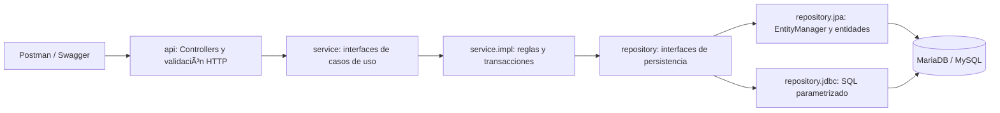

# Arquitectura y principios SOLID

## Flujo por capas

`domain` contiene records inmutables, estados y excepciones sin dependencia
de Spring, JDBC o HTTP. `service.dto` define las solicitudes de casos de uso.
El controlador no conoce JdbcTemplate ni implementaciones concretas.
Los servicios reciben interfaces de repositorio por constructor.

## SOLID aplicado

- **S — responsabilidad única:** controladores traducen HTTP; servicios toman
  decisiones de negocio; repositorios administran persistencia SQL/JPA; el advice traduce errores.
- **O — abierto/cerrado:** una nueva implementación de EquipoRepository puede
  sustituir JDBC sin modificar los consumidores de la interfaz.
- **L — sustitución:** implementaciones respetan los contratos: Optional vacío
  si un ID no existe, lista vacía si no hay filas, ID generado al crear.
  `bloquear` requiere una transacción activa y conserva semántica de consulta.
- **I — segregación:** cuatro contratos de servicio y cuatro de repositorio,
  específicos de recursos; no existe una interfaz universal con métodos vacíos.
- **D — inversión:** capas superiores dependen de interfaces y reciben sus
  dependencias por constructor. Spring configura la implementación concreta.

SOLID no significa crear una interfaz para cada clase. JdbcInsert es un
detalle interno compartido para generar claves y no requiere un contrato público.

## Clean Code

Paquetes en minúsculas, nombres de negocio, DTOs separados de respuestas,
records inmutables, validación de entrada, estados enumerados, errores comunes
y constructor injection. Se elimina field injection en el código activo.
Se conserva el JSON original de deportes para compatibilidad con Postman.
Las consultas usan parámetros; no interpolan valores del usuario en SQL.

## Integridad y concurrencia

FKs impiden borrar deportes con equipos/torneos o entidades con inscripciones.
UNIQUE impide repetir una inscripción incluso bajo concurrencia.
La inscripción bloquea primero la fila del torneo con SELECT FOR UPDATE:
validación de cupos e inserción ocurren en la misma transacción.
Iniciar/finalizar y cancelar usan el mismo bloqueo; no pueden saltarse el cierre.
Después se bloquea el equipo para impedir que cambie de deporte mientras se inscribe.
No se editan equipos inscritos. Cambiar el rango de un deporte no puede
invalidar equipos existentes. No se reduce el cupo por debajo de los inscritos.

La fecha de inicio es informativa/planificada: el inicio se realiza mediante
el caso de uso explícito, no por un proceso automático.
